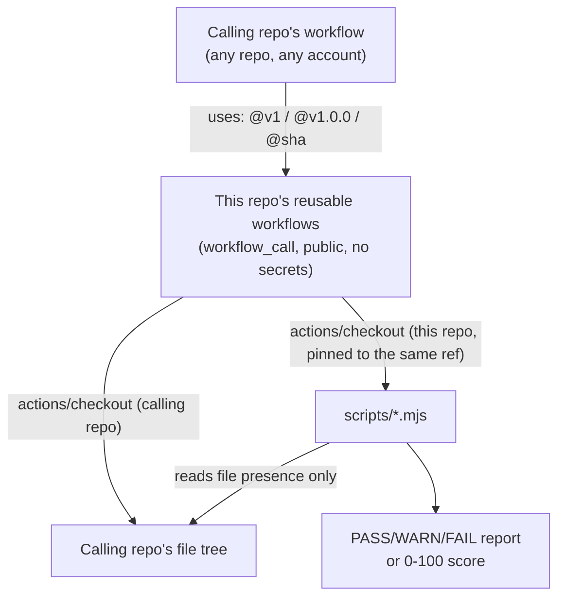

# Architecture

## System diagram



## Repository structure

```
.
├── scripts/
│   ├── check-repo-blueprint.mjs      # required/recommended-tier file-presence checker
│   ├── check-repo-blueprint.test.mjs
│   ├── engineering-score.mjs         # 8-category, 100-point heuristic score
│   ├── engineering-score.test.mjs
│   └── lib/
│       ├── fs-case-insensitive.mjs   # OS-independent path resolution
│       ├── fs-case-insensitive.test.mjs
│       ├── test-detection.mjs        # bounded recursive test-evidence scan
│       └── test-detection.test.mjs
└── .github/
    └── workflows/
        ├── repo-blueprint-check.yml  # reusable (workflow_call)
        └── engineering-score.yml     # reusable (workflow_call)
```

## Key decisions

- **No cross-repo credential, ever.** The reusable workflows check out this repo's own
  scripts using a plain `actions/checkout` against a *public* repository — the calling
  repo's default `GITHUB_TOKEN` is sufficient, because reading a public repo needs no
  authentication at all. This was a deliberate redesign away from an earlier version
  that lived in a private repo and required a fine-grained PAT per calling repo; that
  version worked but didn't scale past a handful of repos without linear
  secret-management overhead. See `RELEASING.md` for how this repo is versioned so
  callers get reproducible behavior without needing any credential.
- **The scripts are checked out at the exact ref the reusable workflow was called
  with** (parsed from `github.workflow_ref`), not always the default branch — a caller
  pinned to `@v1.0.0` or a commit SHA gets exactly that version's behavior.
- **File-presence checking, not content-quality checking.** Deliberately conservative
  scope — this tool answers "is the load-bearing piece present," never "is it good."
  That keeps false-positive risk low and keeps the tool meaningful across wildly
  different repositories and tech stacks.
- **Zero runtime dependencies.** Both scripts and both libraries import only Node.js
  built-ins (`node:fs`, `node:path`). No `npm install` step, no supply-chain surface
  beyond Node itself and the two `actions/*` steps in the workflows.

## Tradeoffs & limitations

See "Known limitations" in [`README.md`](README.md) — JS/TS-only test-detection
conventions, and the accepted (never-observed) edge case around case-variant duplicate
filenames on a case-sensitive filesystem.
